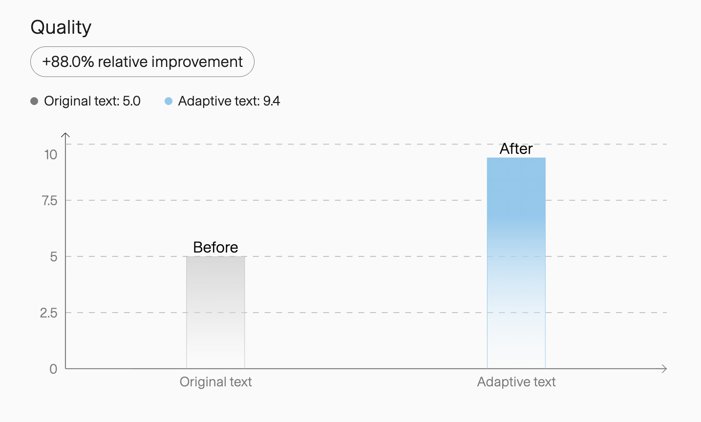
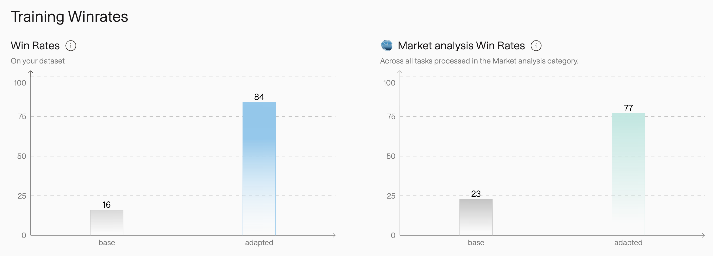
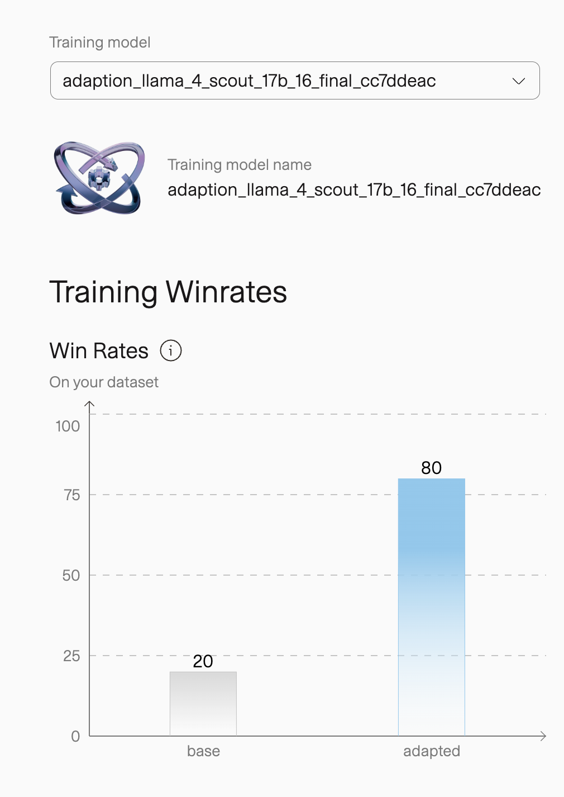

# Experiment History

This record covers the two AutoScientist attempts documented by the public report.

The 0–10 data-quality values below are Adaption platform quality scores; Adaption does not publish their scoring rubric. The evaluation results are platform-reported pairwise preference rates shown as **adapted:base**: the share of comparisons in which a judge preferred the adapted model's response over the base model's response. Neither metric is an accuracy or investment-performance score.

## Attempt #1 — Proof of Concept

**Provided evidence that institutional equity-research reports can be converted into leakage-controlled training data for reconstructing analyst judgments from supplied evidence rather than copying conclusions from the prompt.**

### Data

The project began with roughly 1,500 Southeast Asian institutional sell-side reports. An answer-first extraction workflow identified analyst judgments, removed judgment leakage from the supplied evidence, ranked the remaining evidence, and derived only the analytical task supported by the source.

The curated corpus contained 739 rows:

| Split | Rows |
| --- | ---: |
| Train | 589 |
| Validation | 77 |
| Held out | 73 |

Adaptive Data expanded the 589-row training baseline to 27,862 rows, of which 27,405 were reported as used for training. The Adaption platform quality score increased from 5.0 to 9.4, moving from grade C to grade A.

### Model

| Field | Value |
| --- | --- |
| Base model | `meta-llama/Llama-3.3-70B-Instruct-Reference` |
| Method | LoRA supervised fine-tuning |
| Rank / alpha / dropout | 16 / 32 / 0.05 |
| Target modules | All linear layers |
| Epochs / steps | 2 / 382 |
| Learning rate | `1e-4` |
| Loss | Completions only |
| Training experiment | `22ed78c2-6708-4e15-814f-b2bc73ca95af` |
| Fine-tune job | `140dbd16-fb1d-41da-ac02-b307e8d43024` |

### Results

| Evaluation | Adapted | Base |
| --- | ---: | ---: |
| On-dataset preference | **84%** | 16% |
| Market Analysis preference | **77%** | 23% |

The 84:16 result is an in-distribution diagnostic. Adaption, rather than the project team, constructed the broader Market Analysis category evaluation, so its 77:23 result provides broader-category evidence. Independence from the local 73-row held-out split and complete split hygiene are not established in the public record; neither result establishes accuracy or real-world performance.

### Public releases

- Dataset: [Hugging Face](https://huggingface.co/datasets/huyxdang/adaption-equity-analysis-small) · [Kaggle](https://www.kaggle.com/datasets/huydang03/adaption-equity-analysis-small)
- LoRA adapter: [Hugging Face](https://huggingface.co/huyxdang/adaption_vietnam_equity_research_note) · [Kaggle](https://www.kaggle.com/models/huydang03/adaption-vietnam-equity-research-note/PyTorch/lora)

## Attempt #2 — Scale up

**Expanded source and task coverage from company-level equity research to macro, sector, fund, and fixed-income research.**

### Data

The source corpus expanded from roughly 1,500 to about 7,000 institutional reports. After testing three Adaptive Data recipes, the final run selected Dataset 2, the prompt-and-completion variant, and combined it with `market_analysis_XXL` from Attempt #1.

The released finance dataset contains **34,640 samples**, more than 50 times the original 589-row baseline. AutoScientist added **13,856 synthetic general-purpose examples**, producing a **48,496-example mixture before the training split**. The earlier three-recipe candidate pool is not the finalized dataset.

### Model

| Field | Value |
| --- | --- |
| Base model | `Llama-3.3-70B-Instruct` |
| Method | LoRA supervised fine-tuning |
| Rank | 16 |
| Epochs | 2 |
| Learning rate | `1e-4` |
| Run ID | `adaption_llama_3_3_70b_instru_final_final_8228cf21` |

### Results

| Evaluation | Adapted | Base |
| --- | ---: | ---: |
| On-dataset preference | **87** | 13 |
| Market Analysis preference | **74** | 27 |

These are the platform-reported pairwise preference values, not accuracy. The final run retained strong preference results while broadening its finance coverage and adding general-purpose data. The attempts were not compared head-to-head on identical held-out prompts, so these results do not prove that Attempt #2 is superior overall.

### Public releases

- Dataset: [Hugging Face](https://huggingface.co/datasets/huyxdang/adaption-final-final) · [Kaggle](https://www.kaggle.com/datasets/huydang03/adaption-final-final)
- Model weights: [Hugging Face](https://huggingface.co/huyxdang/adaption_final_final)

## Reading progress across attempts

| Question | Evidence |
| --- | --- |
| Can leakage-controlled financial evidence support analyst-style responses on a broader Adaption category evaluation? | Attempt #1 recorded a 77:23 Market Analysis preference result; clean external transfer is not established. |
| Can the same workflow scale to broader sources and tasks? | Attempt #2 released 34,640 finance samples, used a 48,496-example pre-split mixture, and recorded 87:13 on-dataset and 74:27 Market Analysis preferences. |

The scores must not be ranked as though they came from one controlled benchmark. The datasets and training configurations changed between attempts; the evaluations compare each adapted model with its own base rather than the two adapters directly.

**Attempt #1 used company-level supplied-evidence tasks. Attempt #2 broadened the source coverage and financial task taxonomy. The next step is to test how information propagates through the global financial system.**

See [Future Improvement Roadmap](ROADMAP.md).
